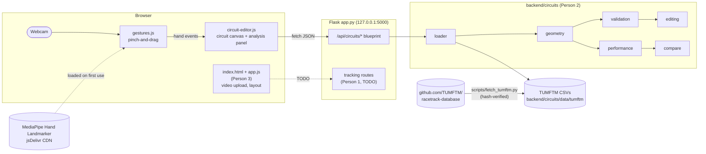
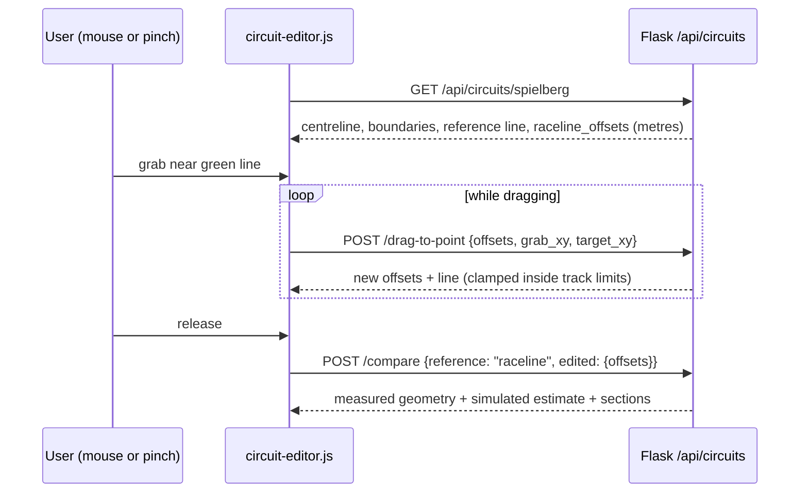

# MotionInk / MotionLink: project handoff summary

> **For a new Claude session:** this is the shared project context. Read it fully before changing code. The repo is `motionlink-feature-frontend` (ask the user to upload it as a zip without `node_modules`/`.venv`). Don't rewrite other people's modules or invent data, telemetry, tracking results or lap times.

## 1. The project

- **Hackathon:** 10 hours, team of 3, track **Voodoo Vision: Computer Vision & Spatial Computing**.
- **Idea:** "MotionInk — Draw the Invisible". Turn movement into visible, editable, measurable trajectories, demoed on Formula 1 footage. The UI brand in the repo is **MotionLink**.
- **Core workflow:** Load video → Track car → Visualise trajectory → Edit racing line → Simulate → Compare.
- **Constraints:** ordinary laptops, no GPU. A working demo comes before ambitious unfinished features.

| Person | Owns | Status |
|---|---|---|
| 1 | Computer vision, video processing, OpenCV tracking (`backend/tracking.py`, `backend/video_processor.py`) | **Not started in repo** (files empty) |
| 2 | Real circuit data, racing-line geometry, performance estimates (`backend/circuits/`) | **Done and integrated** |
| 3 | Frontend, interactive editor, integration (`frontend/index.html`, `app.js`, `style.css`) | UI shell done; circuit panel wired by Person 2 (needs Person 3's review) |

Ground rules:
- **Data:** never fabricate circuit data, telemetry, tracking results or lap times.
- **Coordinates:** keep video pixel coordinates separate from circuit metres. Align video to a circuit only with a real calibration.
- **Labels:** label every time or speed from the model as a **simulated estimate**.
- **Honesty:** don't claim code was tested unless it was.

## 2. How to run (Windows)

```bat
cd <unzipped>\motionlink-feature-frontend     REM the INNER folder that contains app.py
run.bat                                       REM not ./run.bat; in PowerShell use .\run.bat
```

`run.bat`:
1. installs `requirements.txt` (flask, numpy),
2. downloads real circuit data the first time (needs internet),
3. starts the server and opens **http://127.0.0.1:5000**.

Always open the app through that address. Double-clicking `index.html` can't reach the API, and the camera only works on localhost.

On macOS/Linux, run `./run.sh` instead.

Tests:

```bat
python -m unittest discover -s tests -t .
```

Real-data tests skip until the circuit data is downloaded.

## 3. Repository layout

```
motionlink-feature-frontend/
├── app.py                     Flask server: serves frontend/, registers APIs (Person 1 adds tracking here)
├── run.bat / run.sh           one-click setup + start
├── requirements.txt           flask, numpy (Person 1 adds opencv etc.)
├── frontend/
│   ├── index.html             Person 3 (only change: +1 <script src="circuit-editor.js">)
│   ├── app.js, style.css      Person 3 (untouched): navigation, local video upload/playback
│   ├── circuit-editor.js      circuit panel + analysis panel, calls /api/circuits/...
│   └── gestures.js            MediaPipe pinch-and-drag, loaded on demand
├── backend/
│   ├── circuits/              Person 2 module (see section 5)
│   ├── circuit_data.py        re-exports from circuits/ (loader)
│   ├── racing_line.py         re-exports (geometry, editing, validation)
│   ├── performance_model.py   re-exports (performance, compare)
│   ├── tracking.py            EMPTY: Person 1
│   └── video_processor.py     EMPTY: Person 1
├── scripts/fetch_tumftm.py    downloads + verifies circuit data
├── tests/circuits/            26 tests (+2 real-data tests)
└── docs/integration.md, docs/circuits_api.md
```

## 4. Architecture



Editing loop (mouse and hand use the same code path):



## 5. Person 2 module (`backend/circuits/`): done

| File | Purpose |
|---|---|
| `loader.py` | `load_circuit(id)`, `available_circuits()`. Reads TUMFTM CSVs and derives left/right boundaries |
| `geometry.py` | `calculate_path_length`, `calculate_curvature` (uniform resample, Gaussian smoothing, near-zero → exactly 0) |
| `validation.py` | `validate_path` (track-limit check); `project_to_centreline` is sequential and heading-aware, so it's safe at crossovers like Suzuka |
| `editing.py` | Line = one lateral offset per centreline point (+ = left), clamped to track width; `drag_offsets`, `drag_to_point` |
| `performance.py` | `estimate_performance`: point-mass model (curvature speed limit, accel/brake passes, friction ellipse) |
| `compare.py` | `compare_lines` with sections (detected corners/straights, **not** official turn numbers) |
| `api.py` | Flask blueprint (endpoints below) |
| `report.py` | `python -m backend.circuits.report Spielberg` prints a verification report |

### Data source

TUMFTM racetrack-database, https://github.com/TUMFTM/racetrack-database, **LGPL-3.0**:
- **Tracks:** `tracks/<Name>.csv` with columns `x_m, y_m, w_tr_right_m, w_tr_left_m`. The centreline is smoothed OSM GPS data, so it isn't exactly mid-track. Widths come from satellite images.
- **Race lines:** `racelines/<Name>.csv` with columns `x_m, y_m`. They come from a **minimum-curvature optimisation**. They are *not* telemetry and *not* a proven fastest line.
- **Download:** `scripts/fetch_tumftm.py` checks every file against GitHub's git blob hash and writes `manifest.json` (commit, URL, hashes) plus the dataset's LICENSE.
- **Not used:** FastF1 and OpenF1 telemetry are not integrated.

### Coordinates

| Space | Units | Axes |
|---|---|---|
| Circuit (API) | metres | x right, **y up**; origin and orientation arbitrary |
| Canvas / video | pixels | x right, **y down** |

- **Conversion:** `circuit-editor.js` converts with `makeView().toCanvas` / `toMetres`.
- **Signs:** curvature + = left turn; lateral offset + = left of travel. Radius is `null` on straights (|κ| < 1e-4 /m).
- **Video tracks:** they stay in pixels. Mapping them onto the circuit needs a homography from ≥ 4 known track points, which nobody has implemented.

### HTTP API

| Method | Path | Body | Returns |
|---|---|---|---|
| GET | `/api/circuits` | none | downloaded circuits |
| GET | `/api/circuits/<id>` | none | centreline, boundaries, raceline, `raceline_offsets`, `bounds_m`, source |
| POST | `/api/circuits/<id>/analyze` | `{line}` | length, curvature, validation, performance |
| POST | `/api/circuits/<id>/compare` | `{reference, edited, sections?}` | measured, estimated, sections, summary |
| POST | `/api/circuits/<id>/drag-to-point` | `{offsets, grab_xy, target_xy, radius_m?}` | new offsets + line |
| POST | `/api/circuits/<id>/drag` | `{offsets, station_m, delta_m}` | new offsets + line |
| GET | `/api/health` | none | server status + circuits |

A `line`, `reference` or `edited` value can be `"raceline"`, `"centreline"`, `{"offsets": [...]}` or `[[x, y], ...]` in metres. Errors return `{error}` with HTTP 400 or 404.

### Performance model

- **Steps:** `v_lim = min(v_max, sqrt(a_lat_max/|κ|))`, then forward (accel) and backward (brake) passes, then Σ ds / v.
- **Parameters:** `ILLUSTRATIVE_PARAMETERS` = lateral 30 m/s², accel 10 m/s², brake 35 m/s², top speed 90 m/s. These are **round demo assumptions, not real car data**.
- **Output:** is labelled "Simulated estimate … not a real lap time". Use it to compare lines, never as a lap time.

## 6. Gestures (`frontend/gestures.js`)

- **Controls:** click "Hand gestures: off" in the circuit panel. Pinch (thumb + index) = grab, move = bend, open fingers or hand out of view = release.
- **Pinch thresholds:** pinch when thumb–index distance < 0.33 × palm size, release > 0.48 (the gap prevents flicker).
- **Cursor:** smoothed, with 12% frame margin ignored. Grab radius is 28 px for a hand, 14 px for the mouse.
- **Loading:** MediaPipe `@mediapipe/tasks-vision@0.10.14` loads from jsDelivr on first click, falling back to `@latest`. If it can't load, the UI says so, turns the camera off, and the mouse keeps working.

## 7. What is verified vs not

**Verified** (in a sandbox, headless Chrome):
- 26 backend tests pass:
  - curvature of circles, sign, noise robustness, straights exactly zero,
  - corner speed = √(a·R), standing-start kinematics, accel/brake limits, start-point invariance,
  - track-limit violations by side, corner cuts, figure-eight crossover regression,
  - edits stay inside limits, section times sum to the total, all API routes, data import from a clone.
- The integrated page loads a circuit, drags the line, shows the comparison and switches circuits with no JS errors.
- Simulated pinch events grab, bend and release.
- MediaPipe-offline fallback works.

**Not verified:**
- **Real TUMFTM circuits.** The sandbox had no internet; the real-data tests skip until downloaded. After `run.bat`, run the tests and `python -m backend.circuits.report Spielberg`, and compare the length with the published lap length.
- **Exact track filenames** other than `YasMarina.csv`. The fetch script reads the real names from GitHub.
- **Real-hand MediaPipe detection.** Test on the demo laptop; tune `PINCH_ON`/`PINCH_OFF` if it flickers.

## 8. Next steps

1. **Person 1:**
   - Implement tracking in `backend/tracking.py` as a Flask blueprint and register it in `app.py`'s marked block.
   - Return per-frame `{frame, x, y, w, h, ok}` in **video pixels**.
   - Reference: an earlier standalone prototype (`MotionInk.zip`) has a working OpenCV template/CSRT tracker (`motionink/tracking.py`), tested on a synthetic clip. Reuse ideas from it if useful.
2. **Person 3:**
   - Review `circuit-editor.js` and `gestures.js`, and restyle or replace them (the API contract is in `docs/circuits_api.md`).
   - Draw tracked trajectories over the video panel once Person 1's API exists.
3. **Team:** pick the circuit that matches the demo F1 clip and run the report on it.
4. **Optional:** two-car comparison, OpenF1/FastF1 context (only if session, driver and timestamps genuinely match), and video-to-circuit calibration.

## 9. Demo talking points

- **Data:** real circuit geometry from TUMFTM (credit it, LGPL-3.0).
- **Reference line:** "Reference line" = TUMFTM minimum-curvature, not "the fastest line".
- **Editing:** drag or pinch the line; it can't leave the track limits.
- **Results:** measured geometry (length, curvature, track limits) is shown separately from the simulated estimate (time Δ under stated assumptions).
- **Sections:** "Corner n" is a detected section, not an official turn number.
